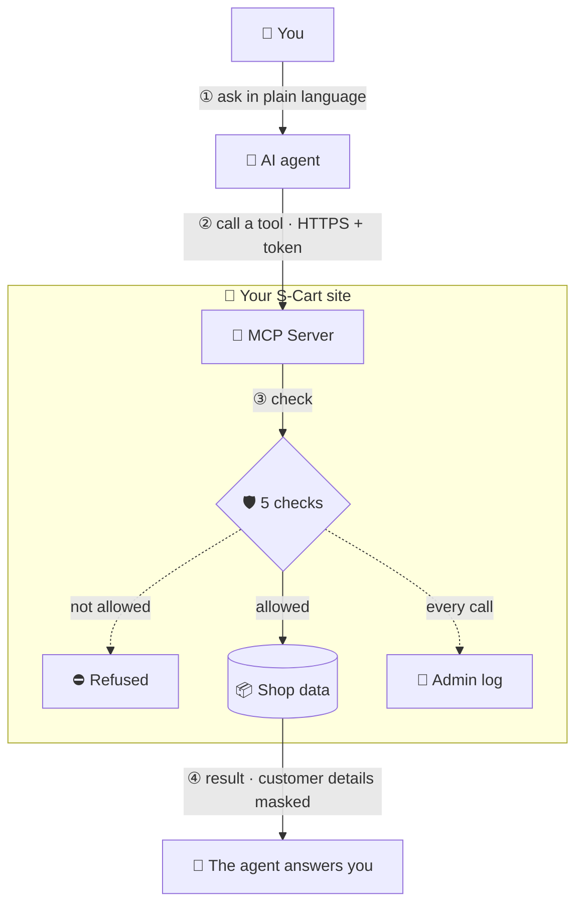
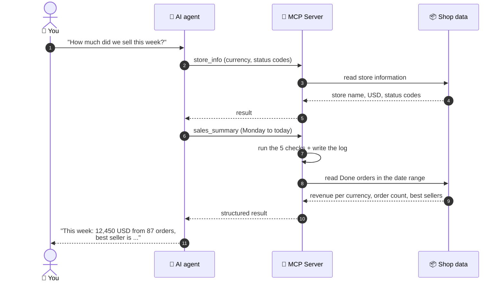
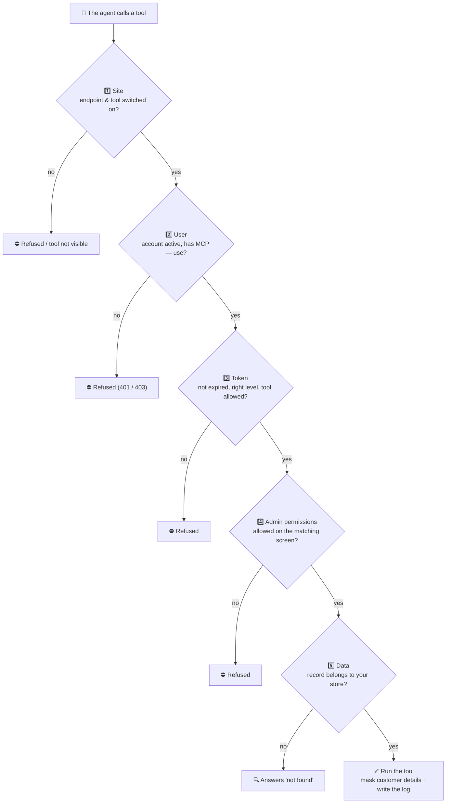
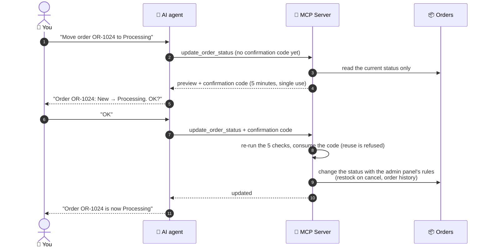

> 🌐 **Language:** [🇻🇳 Tiếng Việt](./readme_vi.md) · 🇬🇧 English (current) · [🇯🇵 日本語](./readme_ja.md)
>
> 💻 **GitHub (source code):** [github.com/gp247-plugin/McpServer](https://github.com/gp247-plugin/McpServer)

# MCP Server — Connect AI agents to your GP247 / S-Cart shop

## Introduction
This document explains how to install and use the free **MCP Server** plugin to connect the AI agent you already use (Claude Code,
Claude Desktop, Cursor, VS Code…) to your S-Cart shop. It is written for shop owners and admin staff, including non-technical
readers. After reading it, you can install the plugin, create a token, connect your agent and ask your shop questions in plain
language — with your data protected by the same permissions as the admin panel.

## What is MCP?
**MCP** (Model Context Protocol) is an open "plug" standard that lets AI agents use the tools of other applications. Once your shop
speaks MCP, you can ask your agent:

- "How much did we sell this week? What are the best sellers?"
- "Which products are running out of stock?"
- "What is the status of order OR-1024, has the customer paid?"
- "Move order OR-1024 to Processing" (when you enable the write tool)

The agent always acts **on behalf of one admin account** and **can never do more** than that account can do in the admin panel.

### The big picture
Without MCP, you open each admin screen, filter, read the numbers and put them together yourself. With MCP, you just ask; the agent
calls the right shop tools, receives the data (already filtered by your permissions) and answers in plain language.



### How one question travels through the system
For example, you ask *"How much did we sell this week?"*:



## Available tools

| Tool | What it does | Needs permission on admin screen |
|---|---|---|
| `store_info` | Store name, base currency, timezone, code tables of order / payment / shipping statuses | — |
| `search_products`, `get_product`, `low_stock_products` | Find products, view details, list low-stock products | Products |
| `list_categories` | Product categories | Categories |
| `search_orders`, `get_order` | Find orders, view order details (lines, totals, history, payments) | Orders |
| `search_customers`, `get_customer` | Find customers, view customer profile | Customers |
| `sales_summary` | Revenue per currency, order counts, best sellers for a date range | Reports |
| `update_order_status` *(write, off by default)* | Change an order status with the same rules as the admin panel (restock on cancel, history) | Edit orders |

The shop owner switches **each tool** on or off for the whole site in **MCP Server settings**.

## Requirements

| Component | Version |
|---|---|
| S-Cart / GP247 core | 3.1 or later (with `gp247/shop`) |
| PHP | 8.3 or later |
| Composer package | `laravel/mcp` ^1.0 |
| Server | HTTPS recommended. **No** cron, queue worker, websocket or Node needed — works on shared hosting |

## Installation

1. Open a **Terminal** in the root folder of your site (the folder containing the `artisan` file), type the line below and press Enter:

   ```
   composer require laravel/mcp:^1.0
   ```

   If it succeeds, the last lines show `No security vulnerability advisories found.`
   Hosting without SSH/Composer: run this command on your computer (with the same site source code), then upload the `vendor/` folder.
2. In the admin panel go to **Extensions → Plugins**, find **MCP Server** and click **Install**.
   If the package from Step 1 is missing, the installer reports that `laravel/mcp` is required and does not install.
3. Go to **System → MCP Server**, click the **MCP Server settings** button in the top-right corner, turn on
   **Turn on the MCP endpoint** and click **Save**.
   The endpoint is the "door" agents call; it is **closed** by default.
4. Give access to staff (skip this if only the top administrator will use it): in the **Roles** management screen, give the
   **"MCP — use (own tokens)"** permission to the roles allowed to use AI agents. **"MCP — configure"** is for people who edit the settings.

## Create a token

A **token** is a personal "key" for one agent, used instead of your password. Each computer or agent should have its own token.

1. Go to **System → MCP Server** (the **MCP tokens** screen). The row of cards at the top shows whether the endpoint is on, how many
   tokens are active, how many are about to expire and how many tools are switched on.
2. In the **Create a token** panel, enter a recognisable **Name**, for example `Laptop – Claude Code`.
3. Choose the **Access level**:
   - **Read only** — look-ups only. Recommended for most cases.
   - **Read + write** — also allows the write tools switched on for the site (this card is greyed out while no write tool is on).
4. Enter **Valid for (days)**. The default is 30 days.
5. (Optional) Open **Limit to these tools** and tick the tools this token may use. Leave empty = every tool of its level.
6. Click **Create token**.
   If it succeeds, a green box shows the token. Click **Copy** and save it right away — **the token is shown only once**. Then click
   **I have copied it**.

## Connect your agent

The endpoint address looks like `https://<your-domain>/api/core/mcp`. At the bottom of the **MCP tokens** screen, the
**Connect your agent** section shows your site's exact address and a configuration snippet for each agent, each with a **Copy**
button. The snippets **do not contain the token**: you put the token in the `GP247_MCP_TOKEN` environment variable (or let VS Code
ask for it).

### Claude Code
1. Put the token in an environment variable. On macOS/Linux, open a Terminal and type (replace `<token>` with the token you copied):

   ```
   export GP247_MCP_TOKEN="<token>"
   ```

   On Windows (PowerShell):

   ```
   $env:GP247_MCP_TOKEN = "<token>"
   ```

2. In the same Terminal window, type (replace `<your-domain>` with your site's domain):

   ```
   claude mcp add --transport http gp247 https://<your-domain>/api/core/mcp --header "Authorization: Bearer $GP247_MCP_TOKEN"
   ```

   If it succeeds, typing `claude mcp list` shows `gp247` in the list with its connection status.

### Cursor
Open Cursor's `mcp.json` file and add (replace `<your-domain>`):

```json
{
  "mcpServers": {
    "gp247": {
      "url": "https://<your-domain>/api/core/mcp",
      "headers": { "Authorization": "Bearer ${env:GP247_MCP_TOKEN}" }
    }
  }
}
```

### VS Code
Create the file `.vscode/mcp.json` in your project and paste (replace `<your-domain>`). VS Code asks for the token when the server starts:

```json
{
  "servers": {
    "gp247": {
      "type": "http",
      "url": "https://<your-domain>/api/core/mcp",
      "headers": { "Authorization": "Bearer ${input:gp247-mcp-token}" }
    }
  },
  "inputs": [
    { "id": "gp247-mcp-token", "type": "promptString", "description": "GP247 MCP token", "password": true }
  ]
}
```

### Claude Desktop / claude.ai
Add a **custom connector** with the endpoint address. If your account offers **Request headers**, set
`Authorization: Bearer <token>`. ChatGPT and connectors without a header option need OAuth — not supported in this version.

## Check the connection
1. At the bottom of the **MCP tokens** screen, click **Check connection**.
2. Read the result:
   - **Green** — the endpoint is reachable and the `Authorization` header reaches the server. You can use your agent.
   - **Red** — the web server drops the `Authorization` header, so agents will be refused (error 401). See Q3 in the Q&A.
   - **Yellow** — the site cannot call itself (endpoint turned off, firewall, or the host blocks loopback calls).
3. Ask your agent something simple, for example "Give me the store information". If it answers with the store name and currency,
   the connection works.

## Data protection
A tool call runs only when **all five layers** allow it:

1. **Site** — the endpoint and that tool are switched on.
2. **User** — the account is active and has the "MCP — use" permission.
3. **Token** — not expired; the right level (*Read only* / *Read + write*); in the list of allowed tools (if limited).
4. **Admin permissions** — the token owner may use the matching admin screen (view for reads, edit for writes).
5. **Data** — only within the account's store scope.



Also:
- **Tokens**: the server stores only a hash (never the original token); revocation takes effect immediately.
- **Write tools** always take two steps — the first call returns only a *preview* with a confirmation code; the agent must ask you
  before calling again with the code.
- **Customer data** (e-mail, phone, address) is **masked** before being sent to the agent and its AI provider, unless you turn on
  "Send customer contact details".
- **Text written by others** (order notes, product descriptions, names…) is marked as data so the agent does not follow
  "instructions" that may be hidden in it.
- **Audit log**: every tool call (success, denied, error) is written to the admin operation log — never the token, the confirmation
  code or raw contact details.
- There is no tool that runs SQL, reads logs or executes system commands.

### Write tools: always preview, then confirm
For example, you tell the agent *"Move order OR-1024 to Processing"* (write tool on, "Read + write" token):



## Multi-store sites
On sites with advanced store partitioning, as long as no MCP store resolver is registered, **only the top administrator** can use
MCP (whole-site scope). Store managers are refused so they can never see another store's data.
A partitioning plugin can register an MCP store resolver in the config key `gp247-config.mcp.store_resolver`
(`callable(AdminUser $user): ?string` — return the store id, or `null` to refuse).

## Uninstall
- **Uninstalling** the plugin removes its settings, menu and permissions and **revokes every MCP token**. Other API tokens are untouched.
- **Disabling** the plugin (without uninstalling) keeps the tokens; the endpoint disappears until you enable it again.

## License
MIT — same as S-Cart.

## Conditions & Rules (know before you act)

**When creating a token**
- **Name is required, at most 100 characters** — so you can tell each computer's/agent's token apart when you need to revoke one.
- **Validity from 1 day up to the maximum in the settings (365 days by default)** — tokens never last forever, so a leaked token
  stops working on its own.
- **A "Read + write" token can only be created when at least one write tool is on** — no write permission that cannot be used.
- **The token is shown only once** — the server does not keep the original token, so it cannot be shown again; if lost, revoke it
  and create a new one.
- **Non-administrators see and revoke only their own tokens** — the top administrator sees and can revoke every token.

**When an agent calls in**
- **A disabled endpoint answers "not found" (404)** — the site does not reveal that the plugin is installed.
- **Expired tokens, revoked tokens and locked accounts are refused the same way (401)** — nobody can guess whether an account exists.
- **Each token is limited to 60 requests/minute (configurable), each IP address to 5 times that** — blocks token guessing and
  protects your hosting from overload.
- **Requests are limited to 64 KB (configurable)**; **browser-based clients may only call from your own site or an origin you
  allow** — so a foreign web page cannot misuse your browser.
- **A tool the user has no permission for is invisible and cannot be called** — even if the agent knows its name.

**When looking things up**
- **At most 50 rows per result page** — keeps the site fast on small hosting.
- **Sales summary covers at most 366 days per call (configurable)** and **never adds currencies together** — USD and VND revenue
  are returned separately.
- **Searching by e-mail only matches the full e-mail** (unless you allow sending contact details) — so nobody can guess a masked
  e-mail piece by piece.
- **Records outside your store scope answer "not found"** — exactly like records that do not exist.

**When changing an order status (write tool)**
- **The confirmation code is valid 5 minutes, single use, and bound to the same token + order + target status** — a different
  target status needs a new preview.
- **Unknown statuses are refused**; **finalised orders (Done / Refunded / Canceled) can still be changed, as in the admin panel**, and
  the preview flags them so you can think twice.
- **Reopening a canceled order is blocked when stock is insufficient** — same as the admin panel, so you never sell what is no longer in stock.
- **While the read-only demo mode (SandboxDemo) is on, every write through MCP is blocked.**

## Q&A

**Q1: My agent gets a 404 error when connecting?**

→ The endpoint is off. Open **MCP Server settings**, turn on **Turn on the MCP endpoint** and click **Save**.

**Q2: The token is correct but the agent still gets 401?**

→ Check that the token has not expired, has not been revoked and that the account that created it is not locked. If all three are
fine, click **Check connection** — the web server most likely drops the header (Q3).

**Q3: "Check connection" says the web server drops the Authorization header — how do I fix it?**

→ Open the file `public/.htaccess` and make sure these two lines are still there (Laravel ships them; they are sometimes removed by edits):

```
RewriteCond %{HTTP:Authorization} .
RewriteRule .* - [E=HTTP_AUTHORIZATION:%{HTTP:Authorization}]
```

If it still fails, ask your hosting provider to enable `CGIPassAuth On`.

**Q4: My agent gets 403?**

→ The account lacks the "MCP — use" permission, the token is not an MCP token (other API tokens do not work), or the site has several
stores and the account is not the top administrator (see Multi-store sites).

**Q5: My agent does not see a tool I need?**

→ Check three things: is the tool switched on in MCP Server settings; is the token limited to other tools; does the account that
created the token have permission on the matching admin screen (for example the Customers screen for `search_customers`).

**Q6: I lost the token I just created?**

→ A token cannot be shown again. Click **Revoke** on that token in the list, then create a new one.

**Q7: Is customer data sent outside my site?**

→ Only the results of the tools the agent calls are sent to the agent (and its AI provider). Customers' e-mail, phone and address are
masked by default. Turn on "Send customer contact details" only if you accept that this data leaves your site.

**Q8: Can the agent change an order status without asking me?**

→ Write tools are off by default and need a "Read + write" token. When on, every status change takes two calls: preview, then
confirm. A well-behaved agent asks you between the two; give write tokens only to agents you trust.

**Q9: My agent gets 429?**

→ Too many requests per minute. Wait a minute and retry, or raise **Requests per minute per token** in the settings.

**Q10: My hosting has no SSH/Composer — how do I install?**

→ On a computer with the site's source code, run `composer require laravel/mcp:^1.0`, upload the `vendor/` folder (plus
`composer.json` and `composer.lock`) to your hosting, then install the plugin as in Step 2.

---

<sub>📅 **Last updated:** 2026-10-22 · ✍️ **Author:** GP247</sub>
