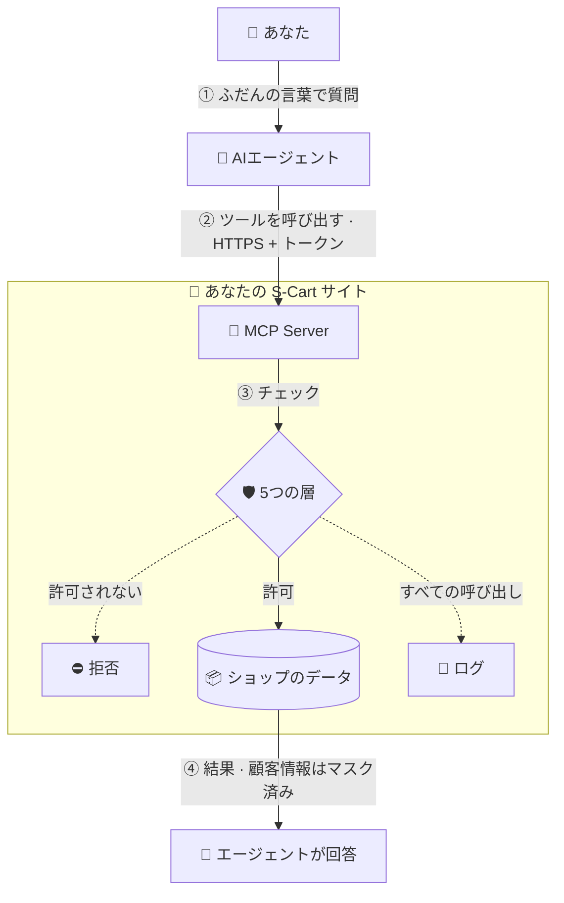
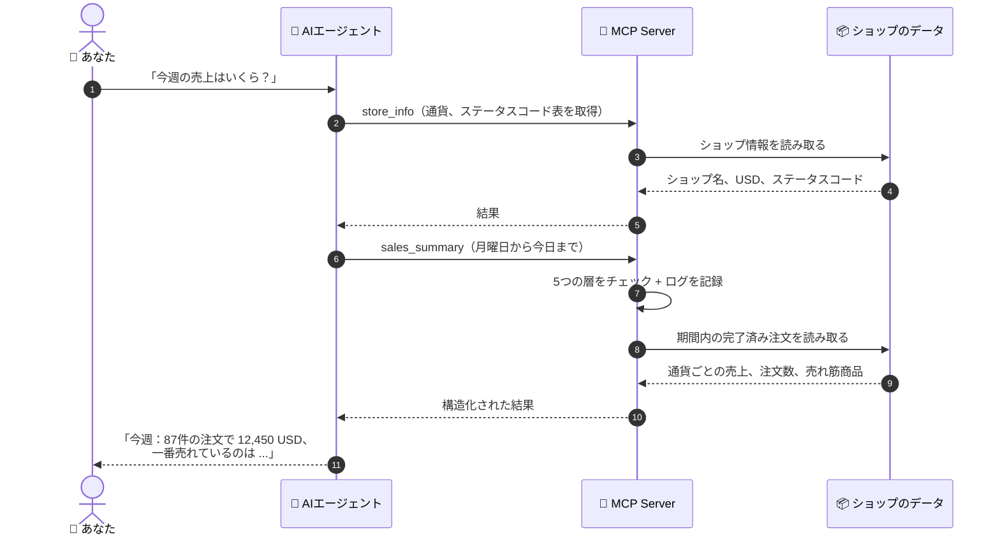
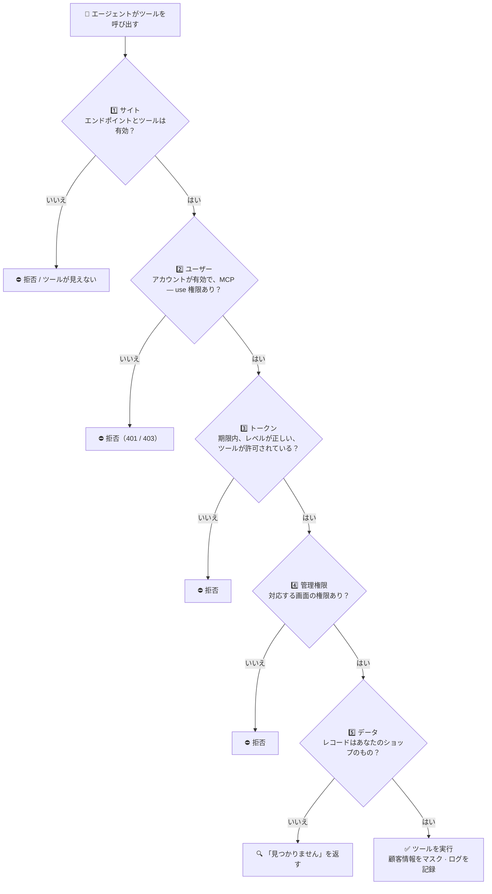
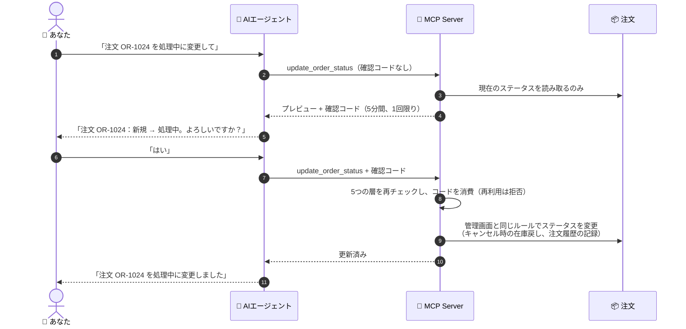

> 🌐 **言語:** [🇻🇳 Tiếng Việt](./readme_vi.md) · [🇬🇧 English](./readme.md) · 🇯🇵 日本語（現在）
>
> 💻 **GitHub（ソースコード）:** [github.com/gp247-plugin/McpServer](https://github.com/gp247-plugin/McpServer)

# MCP Server — AIエージェントを GP247 / S-Cart ショップに接続する

## はじめに
このドキュメントでは、無料プラグイン **MCP Server** をインストールして使い、お使いの AIエージェント（Claude Code、Claude Desktop、Cursor、VS Code…）を S-Cart ショップに接続する方法を説明します。ショップのオーナーや管理スタッフ向けで、技術に詳しくない方も対象です。読み終えると、ご自身でプラグインのインストール、トークンの作成、エージェントの接続を行い、自然な言葉でショップに質問できるようになります。データは管理画面の権限設定どおりに保護されます。

## MCP とは？
**MCP**（Model Context Protocol）は、AIエージェントが他のアプリケーションのツールを使えるようにするオープンな「接続規格」です。ショップが MCP に対応すると、エージェントに次のように質問できます：

- 「今週の売上はいくら？一番売れている商品は？」
- 「在庫切れが近い商品はどれ？」
- 「注文 OR-1024 はどの状態？お客様は支払い済み？」
- 「注文 OR-1024 を処理中に変更して」（書き込みツールを有効にしている場合）

エージェントは常に**1つの管理者アカウントに代わって**動作し、そのアカウントが管理画面でできること**以上のことは決してできません**。

### 全体像
MCP がない場合、各管理画面を自分で開き、絞り込み、数字を読んで集計する必要があります。MCP があれば、質問するだけです。エージェントがショップの適切なツールを自動で呼び出し、（あなたの権限で絞り込まれた）データを受け取り、自然な言葉で回答します。



### 1つの質問がシステムをどう通るか
例えば *「今週の売上はいくら？」* と質問した場合：



## 利用可能なツール

| ツール | 内容 | 必要な管理画面の権限 |
|---|---|---|
| `store_info` | ショップ名、基本通貨、タイムゾーン、注文 / 支払い / 配送ステータスのコード表 | — |
| `search_products`, `get_product`, `low_stock_products` | 商品の検索、詳細の表示、在庫切れが近い商品の一覧 | 商品 |
| `list_categories` | 商品カテゴリー | カテゴリー |
| `search_orders`, `get_order` | 注文の検索、注文詳細の表示（明細、合計金額、履歴、支払い） | 注文 |
| `search_customers`, `get_customer` | 顧客の検索、顧客プロフィールの表示 | 顧客 |
| `sales_summary` | 期間内の通貨ごとの売上、注文数、売れ筋商品 | レポート |
| `update_order_status` *（書き込み、デフォルトは無効）* | 管理画面と同じルールで注文ステータスを変更（キャンセル時の在庫戻し、履歴の記録） | 注文の編集 |

ショップのオーナーは **MCP Server 設定**画面で、サイト全体に対して**ツールごと**に有効/無効を切り替えます。

## 要件

| コンポーネント | バージョン |
|---|---|
| S-Cart / GP247 core | 3.1 以上（`gp247/shop` あり） |
| PHP | 8.3 以上 |
| Composer パッケージ | `laravel/mcp` ^1.0 |
| サーバー | HTTPS を推奨。cron、キューワーカー、websocket、Node は**不要**で、共有ホスティングでも動作します |

## インストール

1. サイトのルートフォルダー（`artisan` ファイルがあるフォルダー）で **Terminal** を開き、次の行を入力して Enter を押します：

   ```
   composer require laravel/mcp:^1.0
   ```

   成功すると、画面の最後に `No security vulnerability advisories found.` という行が表示されます。SSH/Composer が使えないホスティングの場合：このコマンドをお使いのパソコン（サイトと同じソースコード）で実行し、`vendor/` フォルダーをホスティングにアップロードしてください。
2. 管理画面で **Extension → Plugin** を開き、**MCP Server** を探して **インストール** をクリックします。ステップ 1 のパッケージが不足している場合、インストーラーは `laravel/mcp` が不足していると表示し、インストールしません。
3. **システム → MCP Server** を開き、右上の **MCP Server 設定** ボタンをクリックして、**MCP エンドポイントを有効にする** をオンにし、**保存** をクリックします。エンドポイントはエージェントが呼び出す「入口」で、デフォルトでは**閉じて**います。
4. スタッフへの権限付与（最上位の管理者だけが使う場合は省略可）：**ロール（Roles）**管理画面で、AIエージェントを使えるロールに **「MCP — use (own tokens)」** 権限を付与します。**「MCP — configure」** 権限は設定を編集できる人向けです。

## トークンを作成する

**トークン**は、パスワードの代わりに使う、エージェントごとの専用の「鍵」です。パソコンごと、またはエージェントごとに別々のトークンを用意することをおすすめします。

1. **システム → MCP Server**（**MCP トークン**画面）を開きます。上部のカード列には、エンドポイントが有効か無効か、有効なトークンの数、まもなく期限切れになるトークンの数、有効になっているツールの数が表示されます。
2. **トークンを作成** 欄で、分かりやすい **名前** を入力します。例：`Laptop – Claude Code`。
3. **アクセスレベル** を選択します：
   - **読み取り専用** — 照会のみ。ほとんどの場合はこちらを推奨します。
   - **読み取り + 書き込み** — サイトで有効になっている書き込みツールも使えます（サイトで書き込みツールが1つも有効になっていない間、このカードはグレー表示になります）。
4. **有効期間（日）** を入力します。デフォルトは 30 日です。
5. （任意）**これらのツールのみ使用を許可** を開き、トークンで使用を許可するツールにチェックを入れます。空欄 = 同じレベルのすべてのツール。
6. **トークンを作成** をクリックします。成功すると、緑色の枠にトークンが表示されます。**コピー** をクリックしてすぐに保存してください。**トークンは一度しか表示されません**。その後、**コピーしました** をクリックします。

## エージェントを接続する

エンドポイントのアドレスは `https://<your-domain>/api/core/mcp` の形式です。**MCP トークン**画面の下部にある **エージェントを接続** セクションには、サイトの正しいアドレスと各エージェント用の設定スニペットが **コピー** ボタン付きで表示されます。設定スニペットには**トークンは含まれません**。トークンは環境変数 `GP247_MCP_TOKEN` に設定してください（または実行時に VS Code に入力を求めさせます）。

### Claude Code
1. トークンを環境変数に設定します。macOS/Linux では Terminal を開いて次を入力します（`<token>` をコピーしたトークンに置き換えます）：

   ```
   export GP247_MCP_TOKEN="<token>"
   ```

   Windows（PowerShell）の場合：

   ```
   $env:GP247_MCP_TOKEN = "<token>"
   ```

2. 同じ Terminal ウィンドウで次を入力します（`<your-domain>` をサイトのドメインに置き換えます）：

   ```
   claude mcp add --transport http gp247 https://<your-domain>/api/core/mcp --header "Authorization: Bearer $GP247_MCP_TOKEN"
   ```

   成功した場合、`claude mcp list` を入力すると、一覧に `gp247` が接続状態とともに表示されます。

### Cursor
Cursor の `mcp.json` ファイルを開き、次を追加します（`<your-domain>` を置き換えます）：

```json
{
  "mcpServers": {
    "gp247": {
      "url": "https://<your-domain>/api/core/mcp",
      "headers": { "Authorization": "Bearer ${env:GP247_MCP_TOKEN}" }
    }
  }
}
```

### VS Code
プロジェクト内に `.vscode/mcp.json` ファイルを作成し、次を貼り付けます（`<your-domain>` を置き換えます）。VS Code はサーバーの起動時にトークンの入力を求めます：

```json
{
  "servers": {
    "gp247": {
      "type": "http",
      "url": "https://<your-domain>/api/core/mcp",
      "headers": { "Authorization": "Bearer ${input:gp247-mcp-token}" }
    }
  },
  "inputs": [
    { "id": "gp247-mcp-token", "type": "promptString", "description": "GP247 MCP token", "password": true }
  ]
}
```

### Claude Desktop / claude.ai
エンドポイントのアドレスで **custom connector** を追加します。アカウントに **Request headers** の項目がある場合は、`Authorization: Bearer <token>` を設定します。ChatGPT やヘッダー項目のないコネクターには OAuth が必要ですが、このバージョンではまだ対応していません。

## 接続を確認する
1. **MCP トークン**画面の下部で、**接続を確認** をクリックします。
2. 結果を確認します：
   - **緑色** — エンドポイントにアクセスでき、`Authorization` ヘッダーがサーバーに届いています。エージェントを使用できます。
   - **赤色** — Web サーバーが `Authorization` ヘッダーを失っているため、エージェントは拒否されます（エラー 401）。Q&A の質問 3 を参照してください。
   - **黄色** — サイトが自分自身を呼び出せません（エンドポイントが無効、ファイアウォール、またはホスティングがループバック呼び出しをブロックしている）。
3. エージェントに簡単な質問をします。例：「ショップの情報を教えて」。エージェントがショップ名と通貨を返せば、接続は正常に動作しています。

## データの安全性
ツールの呼び出しは、**5つの層すべて**が許可した場合にのみ実行されます：

1. **サイト** — エンドポイントが有効で、そのツールが有効になっている。
2. **ユーザー** — アカウントが有効で、「MCP — use」権限を持っている。
3. **トークン** — 有効期限内で、*読み取り専用* / *読み取り + 書き込み* のレベルが正しく、許可されたツールの一覧に含まれている（制限がある場合）。
4. **管理権限** — トークンの所有者が対応する管理画面の権限を持っている（読み取りには閲覧権限、書き込みには編集権限が必要）。
5. **データ** — アカウントのショップの範囲内のみ。



その他：
- **トークン**：サーバーはハッシュのみを保存します（元のトークンは保存しません）。取り消しは即時に有効になります。
- **書き込みツール**は常に2段階です。最初の呼び出しでは確認コード付きの*プレビュー*のみを返します。エージェントはあなたに確認してから、コードを付けて再度呼び出す必要があります。
- **顧客情報**（メールアドレス、電話番号、住所）は、エージェントおよびエージェントの AI プロバイダーに送信される前に**マスク**されます。ただし、「顧客の連絡先情報を送信」をオンにした場合を除きます。
- **他の人が書いた内容**（注文メモ、商品説明、名前…）はデータとしてマークされるため、エージェントはその中に埋め込まれている可能性のある「命令」に従いません。
- **ログ**：ツールの呼び出しごとに（成功、拒否、エラー）、管理操作ログに記録されます。トークン、確認コード、連絡先情報そのものは記録されません。
- SQL の実行、ログの読み取り、システムコマンドの実行を行うツールはありません。

### 書き込みツール：必ずプレビューしてから確定
例えば、エージェントに *「注文 OR-1024 を処理中に変更して」* と指示した場合（書き込みツールが有効、トークンが「読み取り + 書き込み」）：



## 複数ショップのサイト
高度なショップ分割を行っているサイトでは、MCP 用にショップを特定する方法がまだない場合、**最上位の管理者のみ**が MCP を使用できます（サイト全体の範囲）。各ショップの管理アカウントは拒否されるため、他のショップのデータを見ることは決してありません。分割プラグインは、設定キー `gp247-config.mcp.store_resolver` を通じて MCP 用のショップ特定関数を登録できます（`callable(AdminUser $user): ?string` — ショップ ID を返すか、拒否する場合は `null` を返します）。

## アンインストール
- プラグインを**アンインストール**すると、プラグインの設定、メニュー、権限が削除され、**すべての MCP トークンが取り消されます**。その他の API トークンには影響しません。
- プラグインを**無効化**した場合（アンインストールしない）：トークンはそのまま保持されます。再度有効にするまで、エンドポイントは表示されなくなります。

## ライセンス
MIT — S-Cart と同じです。

## 条件と制約（操作前に理解しておくこと）

**トークンを作成するとき**
- **名前は必須で、最大 100 文字** — 取り消しが必要になったときに、パソコン/エージェントごとのトークンを区別できるようにするためです。
- **有効期間は 1 日から設定の上限（デフォルトは 365 日）まで** — トークンに無期限はなく、漏洩したトークンも自動的に無効になります。
- **「読み取り + 書き込み」トークンは、サイトで書き込みツールが少なくとも1つ有効になっている場合にのみ作成できます** — 使えない書き込み権限を付与しないためです。
- **トークンは一度しか表示されません** — サーバーは元のトークンを保存しないため再表示できません。紛失した場合は取り消して新しいトークンを作成してください。
- **管理者以外のユーザーは自分のトークンのみ表示・取り消しできます** — 最上位の管理者はすべてのトークンを表示・取り消しできます。

**エージェントが呼び出すとき**
- **エンドポイントが無効の場合は「見つかりません」（404）を返します** — サイトはプラグインがインストールされていることを明かしません。
- **期限切れのトークン、取り消し済みのトークン、ロックされたアカウントはすべて同じように拒否されます（401）** — アカウントが存在するかどうかを誰にも推測させないためです。
- **トークンごとに最大 60 リクエスト/分（変更可能）、IP アドレスごとに最大その 5 倍** — トークンの総当たりを防ぎ、ホスティングの過負荷を防ぎます。
- **リクエストは最大 64 KB（変更可能）**、**ブラウザーで動作するクライアントは、サイト自身またはあなたが許可した origin からのみ呼び出せます** — 見知らぬ Web ページがあなたのブラウザーを悪用するのを防ぎます。
- **権限のないツールは、エージェントからは見えず、呼び出すこともできません** — ツール名を知っていても同様です。

**照会するとき**
- **結果は1ページあたり最大 50 行** — 小規模なホスティングでもサイトを高速に保つためです。
- **売上サマリーは1回あたり最大 366 日（変更可能）**で、**通貨をまたいで合算しません** — USD と VND の売上は別々に返されます。
- **メールアドレスによる検索はメールアドレス全体が一致する場合のみ**（連絡先情報の送信をオンにした場合を除く） — マスクされたメールアドレスを少しずつ推測されないようにするためです。
- **あなたのショップの範囲外のレコードは「見つかりません」を返します** — 存在しないレコードとまったく同じです。

**注文ステータスを変更するとき（書き込みツール）**
- **確認コードの有効期間は 5 分、1回限りで、同じトークン + 注文 + 変更先ステータスに紐付けられます** — 別のステータスに変更する場合は、もう一度プレビューする必要があります。
- **存在しないステータスは拒否されます**。**確定済みの注文（完了 / 返金済み / キャンセル済み）も管理画面と同様に変更できます**。プレビューには検討のための注記が表示されます。
- **キャンセルされた注文の再開は、在庫が不足している場合はブロックされます** — 管理画面と同様で、在庫のないものを販売しないためです。
- **読み取り専用デモ（SandboxDemo）が有効な間は、MCP を通じたすべての書き込み操作がブロックされます。**

## Q&A

**質問 1：接続時にエージェントが 404 エラーを報告する？**

→ エンドポイントが無効になっています。**MCP Server 設定** を開き、**MCP エンドポイントを有効にする** をオンにして **保存** をクリックしてください。

**質問 2：トークンは正しいのに、エージェントが 401 を報告する？**

→ トークンが期限内であること、取り消されていないこと、トークンを作成したアカウントがロックされていないことを確認してください。3つとも問題がなければ、**接続を確認** をクリックしてください。Web サーバーがヘッダーを失っている可能性が高いです（質問 3）。

**質問 3：「接続を確認」で Web サーバーが Authorization ヘッダーを失っていると表示される。どう直せばよい？**

→ `public/.htaccess` ファイルを開き、次の2行が残っていることを確認してください（Laravel には標準で含まれていますが、編集時に削除されることがあります）：

```
RewriteCond %{HTTP:Authorization} .
RewriteRule .* - [E=HTTP_AUTHORIZATION:%{HTTP:Authorization}]
```

それでもエラーが出る場合は、ホスティング事業者に `CGIPassAuth On` を有効にするよう依頼してください。

**質問 4：エージェントが 403 を報告する？**

→ アカウントに「MCP — use」権限がない、トークンが MCP トークンではない（その他の API トークンは使えません）、または複数ショップのサイトでアカウントが最上位の管理者ではない（「複数ショップのサイト」の項を参照）のいずれかです。

**質問 5：必要なツールがエージェントに表示されない？**

→ 次の3点を確認してください：MCP Server 設定でそのツールが有効になっているか、トークンが他のツールに制限されていないか、トークンを作成したアカウントが対応する管理画面の権限を持っているか（例：`search_customers` には顧客画面）。

**質問 6：作成したばかりのトークンをなくしてしまった？**

→ トークンは再表示できません。一覧でそのトークンの **取り消し** をクリックし、新しいトークンを作成してください。

**質問 7：顧客データは外部に送信される？**

→ エージェントが呼び出したツールの結果のみが、エージェント（およびエージェントの AI プロバイダー）に送信されます。顧客のメールアドレス、電話番号、住所はデフォルトでマスクされます。このデータがサイトの外に出ることを許容できる場合にのみ、「顧客の連絡先情報を送信」をオンにしてください。

**質問 8：エージェントが私に確認せずに注文ステータスを変更することはある？**

→ 書き込みツールはデフォルトで無効で、「読み取り + 書き込み」トークンが必要です。有効にした場合でも、ステータスを変更するたびにエージェントは2段階（プレビューしてから確定）で呼び出す必要があります。正しく動作するエージェントは2つの段階の間であなたに確認します。書き込みトークンは信頼できるエージェントにのみ付与してください。

**質問 9：エージェントが 429 を報告する？**

→ 1分あたりのリクエスト上限を超えています。1分待ってから再試行するか、設定で **トークンごとの1分あたりのリクエスト数** を増やしてください。

**質問 10：ホスティングに SSH/Composer がない場合、どうやってインストールする？**

→ サイトのソースコードがあるパソコンで `composer require laravel/mcp:^1.0` を実行し、`vendor/` フォルダー（および `composer.json`、`composer.lock`）をホスティングにアップロードしてから、ステップ 2 のとおりにプラグインをインストールしてください。

---

<sub>📅 **最終更新:** 2026-10-22 · ✍️ **作成者 (Author):** GP247</sub>
