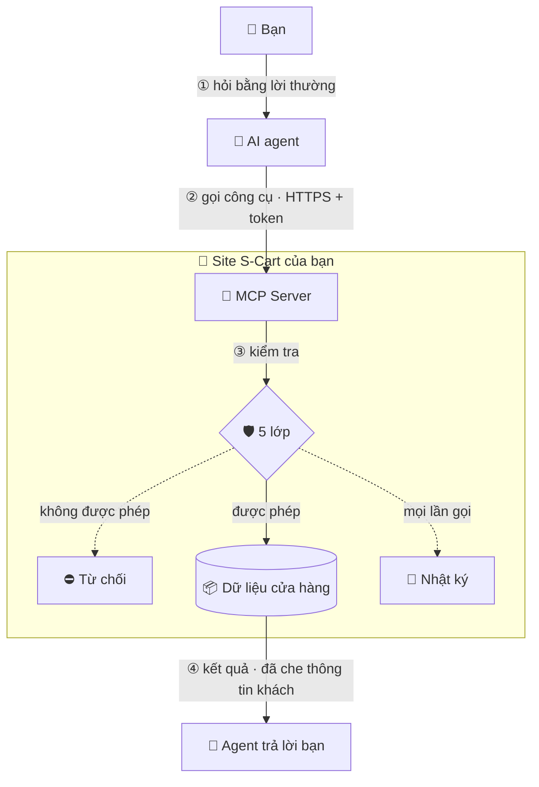
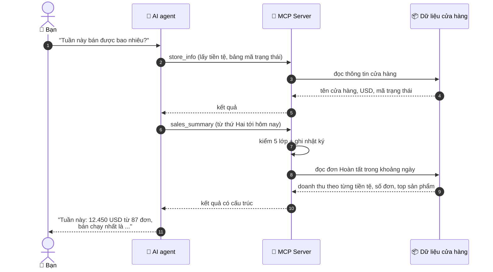
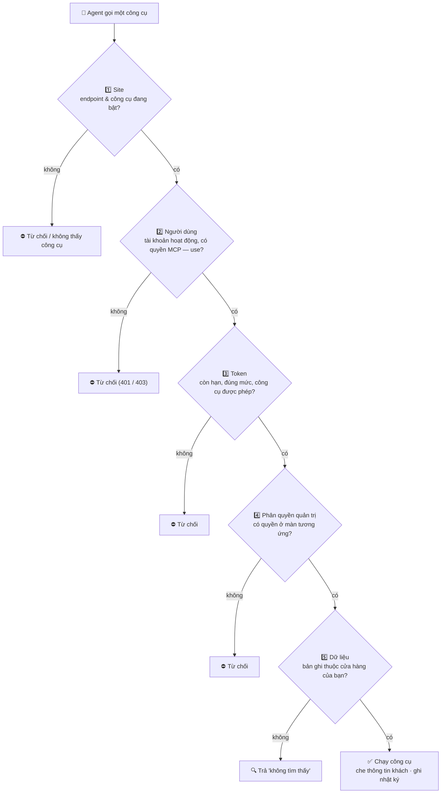
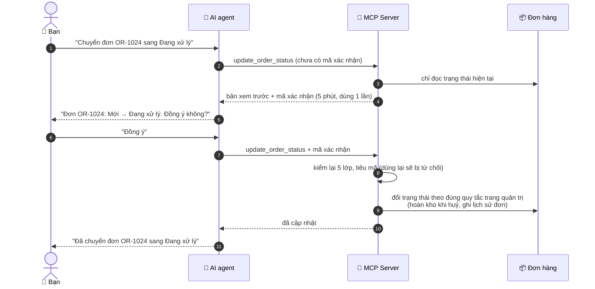

> 🌐 **Ngôn ngữ:** 🇻🇳 Tiếng Việt (hiện tại) · [🇬🇧 English](./readme.md)

# MCP Server — Kết nối AI agent với cửa hàng GP247 / S-Cart

## Giới thiệu
Tài liệu này hướng dẫn cài và dùng plugin miễn phí **MCP Server** để kết nối AI agent bạn đang dùng (Claude Code, Claude Desktop,
Cursor, VS Code…) với cửa hàng S-Cart. Tài liệu dành cho chủ cửa hàng và nhân viên quản trị, kể cả người không rành kỹ thuật.
Đọc xong, bạn tự cài được plugin, tạo token, kết nối agent và hỏi cửa hàng bằng ngôn ngữ tự nhiên — với dữ liệu được bảo vệ
đúng theo phân quyền quản trị.

## MCP là gì?
**MCP** (Model Context Protocol) là một "chuẩn cắm" mở giúp AI agent dùng được công cụ của ứng dụng khác. Khi cửa hàng có MCP,
bạn có thể hỏi agent:

- "Tuần này bán được bao nhiêu? Sản phẩm nào bán chạy nhất?"
- "Những sản phẩm nào sắp hết hàng?"
- "Đơn OR-1024 đang ở trạng thái nào, khách đã thanh toán chưa?"
- "Chuyển đơn OR-1024 sang Đang xử lý" (khi bạn bật công cụ ghi)

Agent luôn hành động **thay mặt một tài khoản quản trị** và **không bao giờ làm được nhiều hơn** tài khoản đó trên trang quản trị.

### Bức tranh tổng thể
Không có MCP, bạn phải tự mở từng màn quản trị, lọc, đọc số rồi tổng hợp. Có MCP, bạn chỉ cần hỏi; agent tự gọi đúng công cụ của
cửa hàng, nhận dữ liệu (đã lọc theo quyền của bạn) và trả lời bằng ngôn ngữ tự nhiên.



### Một câu hỏi đi qua hệ thống thế nào
Ví dụ bạn hỏi *"Tuần này bán được bao nhiêu?"*:



## Công cụ có sẵn

| Công cụ | Làm gì | Cần quyền ở màn quản trị |
|---|---|---|
| `store_info` | Tên cửa hàng, tiền tệ cơ sở, múi giờ, bảng mã trạng thái đơn / thanh toán / giao hàng | — |
| `search_products`, `get_product`, `low_stock_products` | Tìm sản phẩm, xem chi tiết, liệt kê hàng sắp hết | Sản phẩm |
| `list_categories` | Danh mục sản phẩm | Danh mục |
| `search_orders`, `get_order` | Tìm đơn, xem chi tiết đơn (dòng hàng, tổng tiền, lịch sử, thanh toán) | Đơn hàng |
| `search_customers`, `get_customer` | Tìm khách, xem hồ sơ khách | Khách hàng |
| `sales_summary` | Doanh thu theo từng tiền tệ, số đơn, sản phẩm bán chạy trong khoảng ngày | Báo cáo |
| `update_order_status` *(ghi, mặc định tắt)* | Đổi trạng thái đơn với cùng quy tắc như trang quản trị (hoàn kho khi huỷ, ghi lịch sử) | Sửa đơn hàng |

Chủ cửa hàng bật/tắt **từng công cụ** cho cả site trong màn **Cấu hình MCP Server**.

## Yêu cầu

| Thành phần | Phiên bản |
|---|---|
| S-Cart / GP247 core | 3.1 trở lên (có `gp247/shop`) |
| PHP | 8.3 trở lên |
| Gói Composer | `laravel/mcp` ^1.0 |
| Máy chủ | Nên có HTTPS. **Không** cần cron, queue worker, websocket hay Node — chạy được trên shared hosting |

## Cài đặt

1. Mở **Terminal** tại thư mục gốc của site (thư mục có file `artisan`), gõ dòng sau rồi nhấn Enter:

   ```
   composer require laravel/mcp:^1.0
   ```

   Nếu thành công, cuối màn hình có dòng `No security vulnerability advisories found.`
   Hosting không có SSH/Composer: chạy lệnh này trên máy tính của bạn (cùng mã nguồn site), rồi tải thư mục `vendor/` lên hosting.
2. Vào trang quản trị → **Extension → Plugin**, tìm **MCP Server**, bấm **Cài đặt**.
   Nếu thiếu gói ở Bước 1, trình cài đặt sẽ báo thiếu `laravel/mcp` và không cài.
3. Vào **Hệ thống → MCP Server**, bấm nút **Cấu hình MCP Server** ở góc trên bên phải, bật **Bật endpoint MCP** rồi bấm **Lưu**.
   Endpoint là "cổng" để agent gọi vào; mặc định cổng này **tắt**.
4. Phân quyền cho nhân viên (bỏ qua nếu chỉ quản trị viên cao nhất dùng): trong màn quản lý **Vai trò (Roles)**, gán quyền
   **"MCP — use (own tokens)"** cho vai trò được dùng AI agent. Quyền **"MCP — configure"** dành cho người được chỉnh cấu hình.

## Tạo token

**Token** là "chìa khoá" riêng cho từng agent, thay cho mật khẩu của bạn. Mỗi máy hoặc mỗi agent nên có một token riêng.

1. Vào **Hệ thống → MCP Server** (màn **Token MCP**). Hàng thẻ trên cùng cho biết endpoint đang bật hay tắt, số token còn hiệu lực,
   số token sắp hết hạn và số công cụ đang bật.
2. Ở khung **Tạo token**, nhập **Tên** dễ nhận ra, ví dụ `Laptop – Claude Code`.
3. Chọn **Mức truy cập**:
   - **Chỉ đọc** — chỉ tra cứu. Nên dùng cho hầu hết trường hợp.
   - **Đọc + ghi** — được thêm các công cụ ghi đang bật trên site (thẻ này mờ đi khi site chưa bật công cụ ghi nào).
4. Nhập **Hiệu lực (ngày)**. Mặc định 30 ngày.
5. (Tuỳ chọn) Mở **Chỉ cho dùng các công cụ này** và tick những công cụ token được phép dùng. Để trống = mọi công cụ cùng mức.
6. Bấm **Tạo token**.
   Nếu thành công, một khung màu xanh hiện token. Bấm **Sao chép** và lưu ngay — **token chỉ hiện một lần**. Sau đó bấm
   **Tôi đã sao chép**.

## Kết nối agent

Địa chỉ endpoint có dạng `https://<tên-miền-của-bạn>/api/core/mcp`. Ở cuối màn **Token MCP**, phần **Kết nối agent** hiện sẵn địa
chỉ đúng của site và đoạn cấu hình cho từng agent, kèm nút **Sao chép**. Đoạn cấu hình **không chứa token**: bạn đặt token vào biến
môi trường `GP247_MCP_TOKEN` (hoặc để VS Code hỏi khi chạy).

### Claude Code
1. Đặt token vào biến môi trường. Trên macOS/Linux, mở Terminal và gõ (thay `<token>` bằng token vừa sao chép):

   ```
   export GP247_MCP_TOKEN="<token>"
   ```

   Trên Windows (PowerShell):

   ```
   $env:GP247_MCP_TOKEN = "<token>"
   ```

2. Trong cùng cửa sổ Terminal, gõ (thay `<tên-miền>` bằng tên miền site):

   ```
   claude mcp add --transport http gp247 https://<tên-miền>/api/core/mcp --header "Authorization: Bearer $GP247_MCP_TOKEN"
   ```

   Nếu thành công, gõ `claude mcp list` sẽ thấy `gp247` trong danh sách kèm trạng thái kết nối.

### Cursor
Mở file `mcp.json` của Cursor và thêm (thay `<tên-miền>`):

```json
{
  "mcpServers": {
    "gp247": {
      "url": "https://<tên-miền>/api/core/mcp",
      "headers": { "Authorization": "Bearer ${env:GP247_MCP_TOKEN}" }
    }
  }
}
```

### VS Code
Tạo file `.vscode/mcp.json` trong dự án và dán (thay `<tên-miền>`). VS Code sẽ hỏi token khi khởi động server:

```json
{
  "servers": {
    "gp247": {
      "type": "http",
      "url": "https://<tên-miền>/api/core/mcp",
      "headers": { "Authorization": "Bearer ${input:gp247-mcp-token}" }
    }
  },
  "inputs": [
    { "id": "gp247-mcp-token", "type": "promptString", "description": "GP247 MCP token", "password": true }
  ]
}
```

### Claude Desktop / claude.ai
Thêm **custom connector** với địa chỉ endpoint. Nếu tài khoản của bạn có mục **Request headers**, đặt
`Authorization: Bearer <token>`. ChatGPT và connector không có mục header cần OAuth — bản này chưa hỗ trợ.

## Kiểm tra kết nối
1. Ở cuối màn **Token MCP**, bấm **Kiểm tra kết nối**.
2. Đọc kết quả:
   - **Màu xanh** — endpoint truy cập được và header `Authorization` tới được máy chủ. Có thể dùng agent.
   - **Màu đỏ** — máy chủ web đang làm mất header `Authorization`, agent sẽ bị từ chối (lỗi 401). Xem Câu 3 ở mục Hỏi & Đáp.
   - **Màu vàng** — site không tự gọi được chính nó (endpoint đang tắt, tường lửa hoặc hosting chặn gọi vòng).
3. Hỏi agent một câu đơn giản, ví dụ "Cho tôi thông tin cửa hàng". Nếu agent trả về tên cửa hàng và tiền tệ, kết nối đã chạy.

## An toàn dữ liệu
Một lời gọi công cụ chỉ chạy khi **cả năm lớp** cho phép:

1. **Site** — endpoint đang bật và công cụ đó đang bật.
2. **Người dùng** — tài khoản còn hoạt động và có quyền "MCP — use".
3. **Token** — còn hạn; đúng mức *Chỉ đọc* / *Đọc + ghi*; nằm trong danh sách công cụ được phép (nếu có giới hạn).
4. **Phân quyền quản trị** — chủ token có quyền ở màn quản trị tương ứng (đọc cần quyền xem, ghi cần quyền sửa).
5. **Dữ liệu** — chỉ trong phạm vi cửa hàng của tài khoản.



Ngoài ra:
- **Token**: máy chủ chỉ lưu bản băm (không lưu token gốc); thu hồi có hiệu lực ngay.
- **Công cụ ghi** luôn hai bước — lần gọi đầu chỉ trả *bản xem trước* kèm mã xác nhận; agent phải hỏi bạn rồi mới gọi lại kèm mã.
- **Thông tin khách hàng** (email, điện thoại, địa chỉ) được **che** trước khi gửi cho agent và nhà cung cấp AI của agent, trừ khi
  bạn bật "Gửi thông tin liên hệ của khách".
- **Nội dung do người khác viết** (ghi chú đơn, mô tả sản phẩm, tên…) được đánh dấu là dữ liệu để agent không làm theo "lệnh"
  có thể bị chèn trong đó.
- **Nhật ký**: mỗi lần gọi công cụ (thành công, bị từ chối, lỗi) được ghi vào nhật ký thao tác quản trị — không ghi token, mã xác
  nhận hay thông tin liên hệ nguyên văn.
- Không có công cụ chạy SQL, đọc log hay chạy lệnh hệ thống.

### Công cụ ghi: luôn xem trước rồi mới xác nhận
Ví dụ bạn bảo agent *"Chuyển đơn OR-1024 sang Đang xử lý"* (công cụ ghi đã bật, token "Đọc + ghi"):



## Site nhiều cửa hàng
Trên site có phân vùng cửa hàng nâng cao, khi chưa có cách xác định cửa hàng cho MCP, **chỉ quản trị viên cao nhất** dùng được
MCP (phạm vi toàn site). Tài khoản quản lý từng cửa hàng bị từ chối để không bao giờ thấy dữ liệu của cửa hàng khác.
Plugin phân vùng có thể đăng ký hàm xác định cửa hàng cho MCP qua khoá cấu hình `gp247-config.mcp.store_resolver`
(`callable(AdminUser $user): ?string` — trả mã cửa hàng, hoặc `null` để từ chối).

## Gỡ cài đặt
- **Gỡ** plugin: xoá cấu hình, menu, quyền của plugin và **thu hồi mọi token MCP**. Các token API khác không bị ảnh hưởng.
- **Tắt** plugin (không gỡ): giữ nguyên token; endpoint biến mất cho tới khi bật lại.

## Giấy phép
MIT — như S-Cart.

## Điều kiện & ràng buộc (hiểu trước khi thao tác)

**Khi tạo token**
- **Tên bắt buộc, tối đa 100 ký tự** — để bạn phân biệt token của từng máy/agent khi cần thu hồi.
- **Hiệu lực từ 1 ngày tới mức tối đa trong cấu hình (mặc định 365 ngày)** — token không có hạn vĩnh viễn, để token bị lộ cũng
  tự hết tác dụng.
- **Chỉ tạo được token "Đọc + ghi" khi site đã bật ít nhất một công cụ ghi** — tránh cấp quyền ghi không dùng được.
- **Token chỉ hiện một lần** — máy chủ không lưu token gốc nên không thể hiện lại; mất thì thu hồi và tạo token mới.
- **Người không phải quản trị viên chỉ thấy và thu hồi token của chính mình** — quản trị viên cao nhất thấy và thu hồi được mọi token.

**Khi agent gọi vào**
- **Endpoint tắt thì trả "không tìm thấy" (404)** — site không để lộ việc có cài plugin.
- **Token hết hạn, đã thu hồi hoặc tài khoản bị khoá đều bị từ chối như nhau (401)** — không ai đoán được tài khoản còn tồn tại hay không.
- **Mỗi token tối đa 60 request/phút (chỉnh được), mỗi địa chỉ IP tối đa gấp 5 lần** — chặn dò token và chống quá tải hosting.
- **Request tối đa 64 KB (chỉnh được)**; **client chạy trong trình duyệt chỉ được gọi từ chính site hoặc origin bạn cho phép** — chống
  trang web lạ lợi dụng trình duyệt của bạn.
- **Công cụ không có quyền thì agent không thấy và không gọi được** — kể cả khi biết tên công cụ.

**Khi tra cứu**
- **Mỗi trang kết quả tối đa 50 dòng** — giữ site nhanh trên hosting nhỏ.
- **Tổng quan bán hàng tối đa 366 ngày mỗi lần (chỉnh được)** và **không cộng chéo tiền tệ** — doanh thu USD và VND được trả riêng.
- **Tìm theo email chỉ khớp nguyên email** (trừ khi bạn bật gửi thông tin liên hệ) — để không ai đoán dần được email đã bị che.
- **Bản ghi ngoài phạm vi cửa hàng của bạn trả "không tìm thấy"** — giống hệt bản ghi không tồn tại.

**Khi đổi trạng thái đơn (công cụ ghi)**
- **Mã xác nhận có hiệu lực 5 phút, dùng một lần, gắn với đúng token + đơn + trạng thái đích** — đổi sang trạng thái khác phải xem
  trước lại.
- **Trạng thái không tồn tại bị từ chối**; **đơn đã chốt (Hoàn tất / Đã hoàn tiền / Đã huỷ) vẫn đổi được như trên trang quản trị**,
  bản xem trước có ghi chú để bạn cân nhắc.
- **Mở lại đơn đã huỷ bị chặn nếu không đủ tồn kho** — giống trang quản trị, để không bán thứ không còn trong kho.
- **Khi demo chỉ-đọc (SandboxDemo) đang bật, mọi thao tác ghi qua MCP bị chặn.**

## Hỏi & Đáp (Q&A)

**Câu 1: Agent báo lỗi 404 khi kết nối?**

→ Endpoint đang tắt. Vào **Cấu hình MCP Server**, bật **Bật endpoint MCP** rồi bấm **Lưu**.

**Câu 2: Token đúng nhưng agent vẫn báo 401?**

→ Kiểm tra token còn hạn, chưa bị thu hồi và tài khoản tạo token chưa bị khoá. Nếu cả ba đều ổn, bấm **Kiểm tra kết nối** — rất có
thể máy chủ web làm mất header (Câu 3).

**Câu 3: "Kiểm tra kết nối" báo máy chủ web làm mất header Authorization, sửa thế nào?**

→ Mở file `public/.htaccess`, đảm bảo còn hai dòng sau (Laravel có sẵn, đôi khi bị xoá khi chỉnh sửa):

```
RewriteCond %{HTTP:Authorization} .
RewriteRule .* - [E=HTTP_AUTHORIZATION:%{HTTP:Authorization}]
```

Nếu vẫn lỗi, nhờ nhà cung cấp hosting bật `CGIPassAuth On`.

**Câu 4: Agent báo 403?**

→ Tài khoản thiếu quyền "MCP — use", token không phải token MCP (token API khác không dùng được), hoặc site nhiều cửa hàng mà
tài khoản không phải quản trị viên cao nhất (xem mục Site nhiều cửa hàng).

**Câu 5: Agent không thấy một công cụ mà tôi cần?**

→ Kiểm tra ba chỗ: công cụ có đang bật trong Cấu hình MCP Server không; token có bị giới hạn ở công cụ khác không; tài khoản tạo
token có quyền ở màn quản trị tương ứng không (ví dụ màn Khách hàng cho `search_customers`).

**Câu 6: Tôi lỡ làm mất token vừa tạo?**

→ Token không thể hiện lại. Bấm **Thu hồi** token đó trong danh sách rồi tạo token mới.

**Câu 7: Dữ liệu khách hàng có bị gửi ra ngoài không?**

→ Chỉ kết quả của công cụ agent gọi được gửi tới agent (và nhà cung cấp AI của agent). Email, điện thoại, địa chỉ của khách được che
mặc định. Chỉ bật "Gửi thông tin liên hệ của khách" khi bạn chấp nhận dữ liệu này rời khỏi site.

**Câu 8: Agent có tự đổi trạng thái đơn mà không hỏi tôi không?**

→ Công cụ ghi mặc định tắt, và cần token "Đọc + ghi". Khi bật, mỗi lần đổi trạng thái agent phải gọi hai bước: xem trước rồi mới
xác nhận. Agent đúng chuẩn sẽ hỏi bạn ở giữa hai bước; hãy chỉ cấp token ghi cho agent bạn tin cậy.

**Câu 9: Agent báo 429?**

→ Vượt giới hạn request mỗi phút. Chờ một phút rồi thử lại, hoặc tăng **Số request mỗi phút cho mỗi token** trong Cấu hình.

**Câu 10: Hosting của tôi không có SSH/Composer thì cài thế nào?**

→ Trên máy tính có mã nguồn site, chạy `composer require laravel/mcp:^1.0`, rồi tải thư mục `vendor/` (và `composer.json`,
`composer.lock`) lên hosting, sau đó cài plugin như Bước 2.

---

<sub>📅 **Cập nhật lần cuối:** 2026-10-10 · ✍️ **Tác giả (Author):** GP247</sub>
